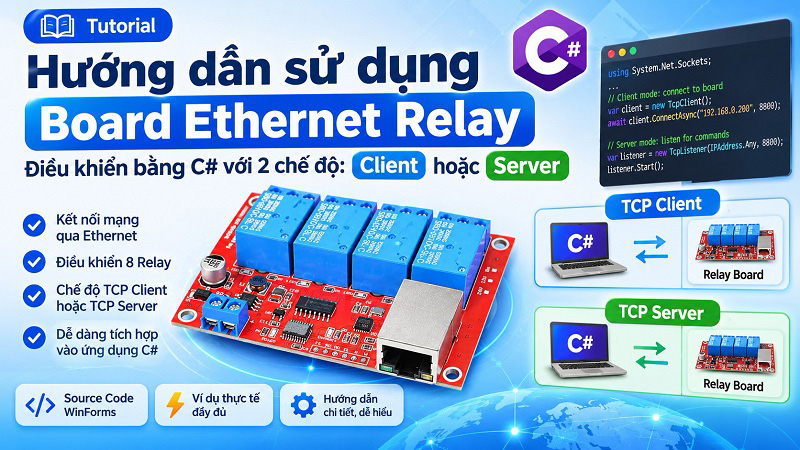

# Ethernet Relay Board Control

Source code C# điều khiển board Ethernet Relay qua mạng TCP/IP.

## Tính năng
- Hỗ trợ board hoạt động ở chế độ **Client** hoặc **Server**.
- Gửi lệnh bật/tắt từng relay hoặc tất cả relay.
- Có tool cấu hình board `CH9120NetModuleConfig.exe`.

## Cấu hình mặc định
- Mode: TCP/IP Client
- Board IP: `192.168.1.200`
- Target IP: `192.168.1.100`
- Target Port: `8800`

Địa chỉ IP và cổng có thể cần thay đổi theo cấu hình mạng thực tế.

## Lệnh điều khiển

| Relay | Bật (ON) | Tắt (OFF) |
|---|---|---|
| 1 | `00 F1 FF` | `00 01 FF` |
| 2 | `00 F2 FF` | `00 02 FF` |
| 3 | `00 F3 FF` | `00 03 FF` |
| 4 | `00 F4 FF` | `00 04 FF` |
| 5 | `00 F5 FF` | `00 05 FF` |
| 6 | `00 F6 FF` | `00 06 FF` |
| 7 | `00 F7 FF` | `00 07 FF` |
| 8 | `00 F8 FF` | `00 08 FF` |
| Tất cả | `00 F9 FF` | `00 09 FF` |

## Build
Mở solution `RelayControlNetFx.sln` bằng Visual Studio và build project.

## Tham khảo
- Bài hướng dẫn: https://thigiacmaytinh.com/huong-dan-lap-trinh-dieu-khien-board-ethernet-relay/
- GitHub: https://github.com/thigiacmaytinh/EthernetRelayBoard
